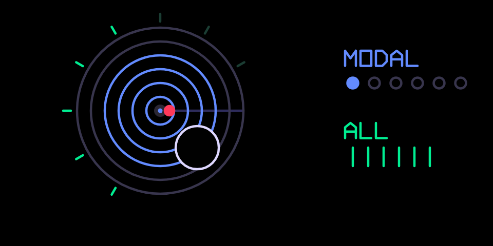
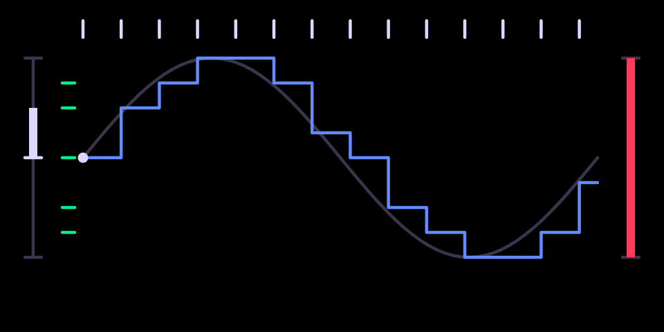
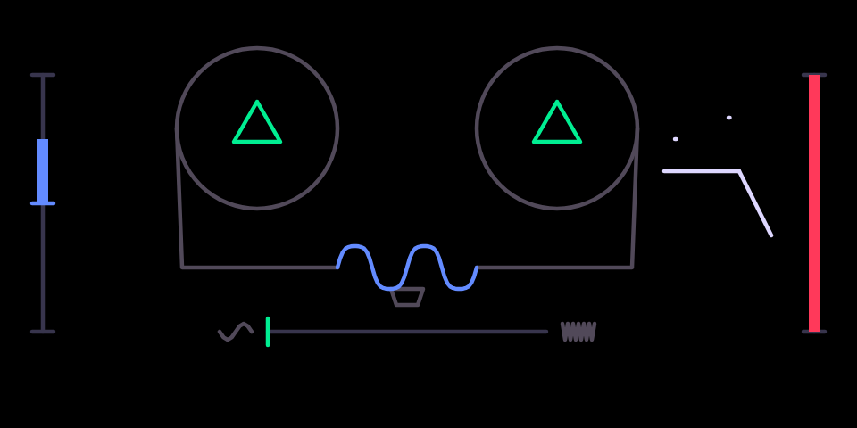
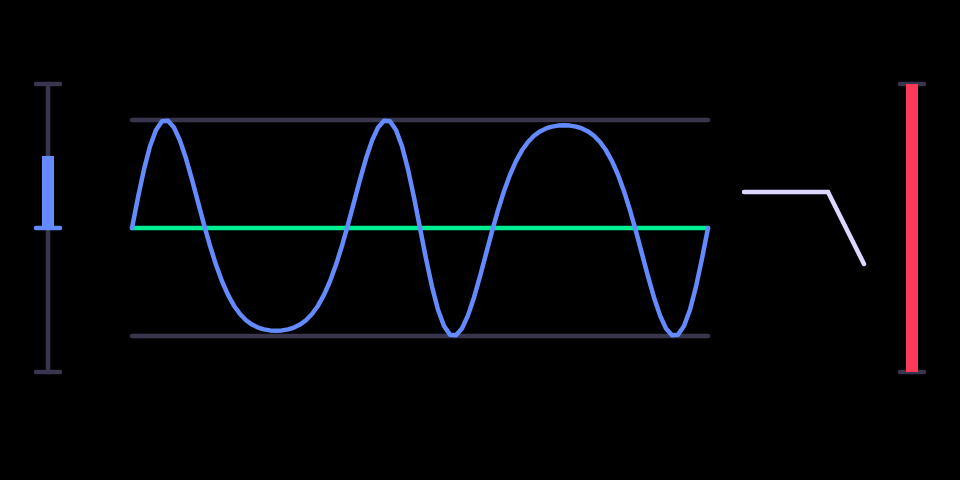
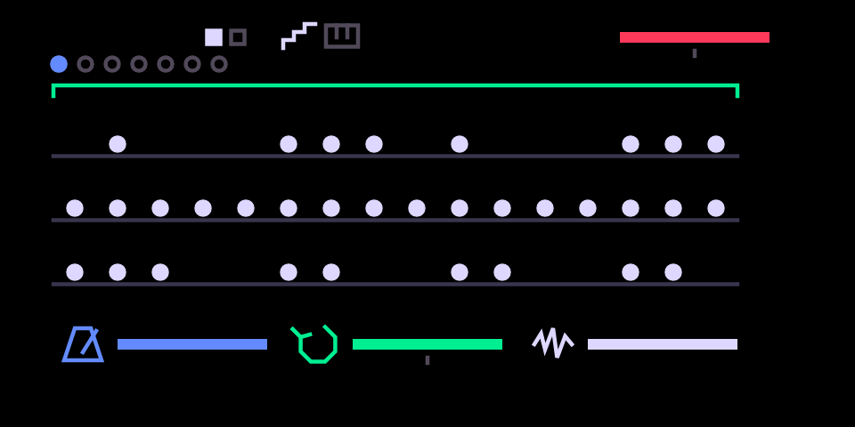
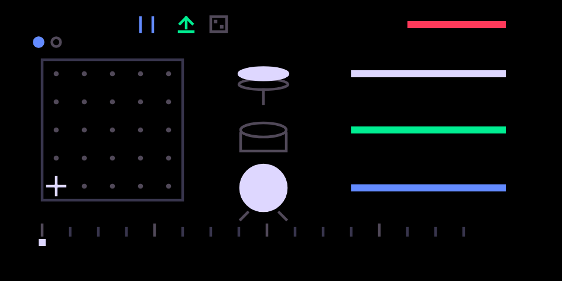

# a word of thanks written by a human
Below are the all the necessary details for installing and using the plugins shared here. All of this stands on the shoulders of the community, and so I extend an enormous thank you to all those involved. 

# Ten plugins for the OP-1 (hundekraft kennel)

Ten add-ons for the **original OP-1** running the [hundekraft](https://hundekraft.github.io/op1-workshop/) firmware: one synth engine, seven effects and two sequencers. Each is a single `.knl` file that you install over USB from the hundekraft workshop in your browser. Nothing is flashed by hand, and the OP-1 can always start without them.

Four of them are ports of Mutable Instruments Eurorack modules (Rings, Marbles, Grids, and the frequency shifter from Warps); the rest are our own DSP. Every plugin has its own animated screen, drawn in the OP-1's colour language: **the colour of a thing on screen is the colour of the encoder that moves it**.

| Plugin | Type | In one line | File |
|---|---|---|---|
| [rings](#rings) | synth | Mutable Instruments Rings: a physical-modelling resonator, six models, up to six voices | `plugins/rings.knl` |
| [bitcrusher](#bitcrusher) | effect | sample-rate and bit-depth reduction with a jittery clock | `plugins/bitcrusher.knl` |
| [drive](#drive) | effect | valve-style overdrive with tone and bias | `plugins/drive.knl` |
| [tape drive](#tape-drive) | effect | tape saturation, wow and flutter, worn-tape darkening | `plugins/tape_drive.knl` |
| [wavefolder](#wavefolder) | effect | West Coast wavefolding | `plugins/wavefolder.knl` |
| [freq shift](#freq-shift) | effect | Bode frequency shifter and ring modulator, with barber-pole feedback and stereo spread | `plugins/freq_shift.knl` |
| [ensemble](#ensemble) | effect | chorus to string-machine ensemble | `plugins/ensemble.knl` |
| [tape echo](#tape-echo) | effect | three-head tape delay with tempo lock, hold and self-oscillation | `plugins/tape_echo.knl` |
| [marbles](#marbles) | sequencer | Mutable Instruments Marbles: random rhythms and melodies with memory | `plugins/marbles.knl` |
| [grids](#grids) | sequencer | Mutable Instruments Grids: a map of drum grooves, with Euclidean mode | `plugins/grids.knl` |

---

## Before you start

- **An original OP-1** (the 2011 model). These do not run on the OP-1 field or the OP-Z.
- **hundekraft 3.0.3** installed on it. Get it from the [hundekraft workshop](https://hundekraft.github.io/op1-workshop/) and follow its own install guide first. The plugins were built against the 3.0.3 SDK and need that core.
- **Chrome** (or another browser with Web MIDI) and a USB cable.
- A backup of your tape and sounds. A plugin runs as firmware code, so treat these files like any firmware: only install plugins from people you trust.

The OP-1's recovery is unchanged by all of this. If it ever fails to start after you add a file, switch it off and on again: it starts once without plugin files, and you can remove the file from the workshop. The firmware update menu (hold COM while switching on) is always there too.

## Installing

1. Open the [hundekraft workshop](https://hundekraft.github.io/op1-workshop/) in Chrome and connect the OP-1 over USB.
2. Open **Your plugins** (it sits in the same category list as the synths, effects and tools) and drop the `.knl` files from `plugins/` onto it, or choose them with the file picker. The page checks each file and keeps it in the browser.
3. Press **Update OP-1**. The review lists each new plugin with an on/off switch. Read it and send.
4. On the OP-1, press **T1** to confirm. It installs the files and restarts.
5. Back in the browser, press **Refresh** to verify. Each plugin now shows as installed.

You can install all ten at once. Together they take about 530 KB of the firmware's 2 MB plugin area, and they sit next to hundekraft's own plugins without conflicts.

**Removing** a plugin: in Your plugins, press Remove, then Update OP-1 and confirm with T1. A sound that used a removed synth plays as the stock Iter engine, a removed effect as the stock filter, and the sound remembers its name, so it comes back as it was if you reinstall.

**Replacing** a plugin with a newer file: remove it, let the OP-1 restart, then add the new file. Installing a same-name file straight over the old one can hang the restart on the "kennel: updated" screen. If that happens, switch the OP-1 off and on.

Installed plugin files live on the OP-1 itself and survive a factory reset and a firmware reinstall. The workshop's installed-plugin list is how you find and remove them later.

## How the controls work

The same rules hold on every plugin, so once you know one you know them all.

- **Picking a plugin.** Each one is an entry in the normal lists. Synth: hold Shift and press T1, turn blue to **rings**, press to load. Effect: hold Shift and press T3 on a synth or drum sound, or on the master in the mixer, and pick the effect. Sequencer: hold Shift and press the sequencer key and pick **marbles** or **grids**. The names appear with spaces, as in "tape echo" and "freq shift".
- **Four encoders, four colours.** Blue, green, white and orange turn the four knobs shown on screen. Everything on the screen that moves with a knob is drawn in that knob's colour.
- **Pressing an encoder opens its second page.** On every effect, pressing **blue** turns the blue knob into the **input gain** (−6 dB to +6 dB, 0 dB at the centre) while it is pressed, and the screen shows a bracket and a dB readout. Some plugins have a second or third press, listed below. Release the knob and the page closes.
- **Shift + turn is fine control.** On a second-page knob, holding Shift makes each click a small step (a tenth of a dB for the gains). On the main page the OP-1's own Shift fine-adjust applies as it does to the stock engines.
- **Mix is always orange** on the effects, and the orange bar at the right edge of every effect screen shows it.
- **Effects are stereo on the master, mono on a synth or drum.** Controls that only make sense in stereo (ensemble's second lane, freq shift's spread) only act on the master.
- **What is saved.** The four knobs and the second-page settings are stored with the sound, as the stock knobs are. Momentary latches (tape echo's hold) are not.

---

## rings

**Mutable Instruments Rings**, the Eurorack resonator, as a synth engine. A key strikes or bows a resonator and the resonator sings. There are six models, chosen on the blue knob's second page:

1. **modal**: a bank of band-pass resonators struck by the key, like a bar or a plate. Structure spaces them from harmonic to inharmonic.
2. **sympathetic strings**: Karplus-Strong strings that resonate with each other, two per voice.
3. **inharmonic string**: one string with dispersion and modulation.
4. **FM voice**: two-operator FM with feedback.
5. **quantized sympathetic strings**: the strings tuned to a chord table.
6. **string + reverb**: strings into a shared reverb.

| Encoder | Main page | Press, then turn |
|---|---|---|
| blue | **structure**: the spacing of the modes or the coupling of the strings | **model**, one of the six per click |
| green | **brightness**: how bright the excitation is and how many modes sound | **polyphony**: all (six voices), 1, 2 or 4 |
| white | **damping**: decay time, clockwise = longer | |
| orange | **position**: where the string or plate is struck | |

Fewer voices buy more detail: at polyphony 1 the single voice gets every mode or string the engine can afford. "All" is six voices. The stock T2 envelope shapes the sound after the resonator as it does for every engine, so set a release there if the rings cut off too early. The sound is heavy on the CPU at "all" next to big effects on the master; polyphony 4 leaves room.

**On screen:** the rings light up from the centre with structure, the rays round them with brightness. The pad at the lower right lifts off the rings as damping rises, and the red dot is the strike position. Each voice that sounds sends a ripple out from the core, and the core glows with the total level. The MODEL and POLY rows on the right show the two settings; while a knob is on its second page the row is bracketed and shown in white.

## bitcrusher

A **bit crusher**. It lowers the sample rate (each sample is held for longer, which turns the sound gritty and adds metallic aliasing) and the bit depth (fewer levels, so it gets noisy and steppy). **Jitter** makes the sample clock unsteady, like a dying sampler. From a subtle 12-bit grit to 2-bit destruction.

| Encoder | Main page | Press, then turn |
|---|---|---|
| blue | **rate**: the sample rate, clockwise = higher, cleaner; anticlockwise down to 500 Hz | **input gain** −6 to +6 dB (Shift: tenths) |
| green | **bits**: the bit depth, clockwise = more bits; anticlockwise down to 2 | |
| white | **jitter**: randomness of the sample clock | |
| orange | **mix** | |

**On screen:** a smooth wave and its stepped copy. The steps get wider as the rate drops, the green ladder on the left gains rungs as the bits go (the levels the sound is rounded to), and the row of clock ticks along the top shakes with jitter. The dot runs along the stairs at the sample clock's speed. The blue bar at the left edge is the input gain; it warms towards white as the input gets loud.

## drive

An **overdrive**. The signal is pushed into a soft clipper that rounds the peaks off, with a tone control after it and a **bias** that makes the clipping lopsided. Symmetric clipping adds odd harmonics, buzzy like a fuzz pedal; asymmetric clipping adds even harmonics, warmer like a valve. The level stays roughly constant as the drive goes up, and it runs oversampled so it stays clean of aliasing.

| Encoder | Main page | Press, then turn |
|---|---|---|
| blue | **drive**: how hard the signal hits the clipper, 0 to +36 dB | **input gain** −6 to +6 dB (Shift: tenths) |
| green | **tone**: a tilt after the clipper, dark anticlockwise, bright clockwise, flat at the centre | |
| white | **bias**: symmetric (odd harmonics) to lopsided (even harmonics) | |
| orange | **mix**, auto-levelled | |

**On screen:** a valve stage. The blue diode pair fills from the tips as drive goes up, the valve's filament and glow warm with bias, and the green curve on the right tilts with tone. The wiper on the input pot is the input gain; while blue is pressed the dB readout appears.

## tape drive

A **tape machine in a box**: gentle saturation like recording hot to tape, a low head bump, high-frequency loss, **wow and flutter** (the pitch wobble of an uneven transport) and some hiss. Run a synth or the whole mix through it and it sounds like it came off a worn cassette or a reel-to-reel.

| Encoder | Main page | Press, then turn |
|---|---|---|
| blue | **saturate**: how hot the tape is driven, clean to compressed and warm | **input gain** −6 to +6 dB (Shift: tenths) |
| green | **wobble**: the amount of pitch wobble, slow deep wow at the bottom, fast flutter at the top | |
| white | **age**: clockwise = a newer tape; anticlockwise adds high-frequency loss and hiss | |
| orange | **mix** | |

**On screen:** two reels and the tape path. The wave on the tape between them grows and flattens as saturate rises, the reels shake at the wobble rate (slow for wow, fast for flutter, with the marker on the scale below showing where you are), and at the right the low-pass glyph closes and the specks of hiss count up as the tape ages. The gain and mix bars sit at the edges as on every effect.

## wavefolder

A **wavefolder**, the West Coast synth trick. Instead of clipping the peaks off it folds them back down, so a sine wave that is pushed harder grows extra wiggles in its tops and bottoms. Bright, metallic, vocal and very synthy, and it changes dramatically with the level you feed it. Best on a synth. Oversampled and antialiased.

| Encoder | Main page | Press, then turn |
|---|---|---|
| blue | **fold**: the gain into the folder, the number of folds | **input gain** −6 to +6 dB (Shift: tenths) |
| green | **symmetry**: a DC offset before the folder; off-centre it folds only the top or only the bottom | |
| white | **tone**: a low-pass after the folder, dark to bright, to tame the fizz | |
| orange | **mix** | |

**On screen:** one cycle of the output wave gains more and more folds as fold rises. The green centre line moves up or down with symmetry, and the low-pass slope at the right opens with tone.

## freq shift

Two effects in one, picked on the green knob's second page:

- **Frequency shifter** (Bode style, the algorithm from Mutable Instruments Warps). It moves every frequency in the sound up or down by the same number of hertz. Unlike pitch shifting, the harmonics stop lining up: small shifts give a phasing, beating shimmer, large ones turn sounds clangorous and bell-like. **Feedback** sends the output back in, so the sound climbs or falls endlessly like a barber-pole. On the master, **spread** shifts the left channel up and the right down for instant width.
- **Ring modulator** (Warps' diode model). It multiplies the sound by a sine wave at the shift frequency, giving the sum and difference frequencies: robotic, metallic, Dalek voices.

| Encoder | Main page | Press, then turn |
|---|---|---|
| blue | **shift**: −2 kHz to +2 kHz, 0 at the centre, fine near 0 (ring mod: the carrier frequency) | **input gain** −6 to +6 dB (Shift: tenths) |
| green | **feedback**: output back into the input, barber-pole sweeps | **mode**: frequency shifter or ring modulator, one click flips it |
| white | **spread**: left shifted up and right down by this much (master only) | |
| orange | **mix** | |

**On screen:** a dial. The blue needle is the shift; on the master it splits into two needles as spread parts the channels. The green arcs show the feedback and its direction, climbing or falling, and ripples spread from the hub as the input plays. The marks at the top left show the mode: the arrow for the shifter, the circle for the ring modulator; a bracket surrounds them while green is pressed.

## ensemble

A **chorus / string ensemble**. Copies of the signal are delayed by a few milliseconds and the delays are swept by slow LFOs, so the copies drift in pitch against each other. With one copy per side it is a classic chorus, wide and shimmering. With three phase-spread copies per side it becomes the ensemble sound of 1970s string machines like the Solina: lush, thick and slowly swirling. The stock OP-1 has no chorus.

| Encoder | Main page | Press, then turn |
|---|---|---|
| blue | **rate**: LFO speed, 0.05 to 8 Hz | **input gain** −6 to +6 dB (Shift: tenths) |
| green | **depth**: how far the delays sweep | |
| white | **voices**: one sweeping copy per side (chorus) to three (ensemble) | |
| orange | **mix** | |

**On screen:** two lanes, left and right (the second appears on the master). Each voice is a green mark that sways about its home on the lane with the LFO, further with depth and faster with rate; more marks appear as voices goes up. The dot on the dial at the right circles at the LFO rate, and the blue bar under it is the rate.

## tape echo

A **tape echo** in the style of a Space Echo or an Echoplex. The sound is recorded onto a loop of tape and played back by up to three heads at different distances, so the repeats fall in a rhythm. Each repeat goes back through the tape and comes out a little darker, more saturated and more wobbly than the one before. Turned up, the feedback self-oscillates into a dub howl. Changing the time while it repeats bends the pitch of the echoes, as speeding up a real tape does. The wow and flutter model is from Mutable Instruments Beads; the saturation is the same as tape drive's.

| Encoder | Main page | Press, then turn |
|---|---|---|
| blue | **time**: 30 ms to 1.5 s. **Shift + blue locks the time to the tempo**, see below | **input gain** −6 to +6 dB (Shift: tenths); scales what reaches the record head only |
| green | **feedback**: how many repeats; the top of the range self-oscillates | press = **hold** (a latch): the input is cut and the loop repeats what it holds until you press again |
| white | **age**: wow and flutter, darkening and saturation per repeat, new tape to worn | **head pattern**, one click per pattern: head 3; heads 2+3; 1+2+3; 1+3 |
| orange | **mix** | |

**Tempo lock.** Hold Shift and turn blue on the main page: each click steps the time through the project tempo's divisions, 1/16T, 1/16, 1/8T, dotted 1/16, 1/8, 1/4T, dotted 1/8, 1/4, 1/2T, dotted 1/4 and 1/2, shortest first, clockwise = longer (divisions over 1.5 s at the current tempo are skipped). The repeats stay on the grid while you play; turning blue without Shift frees the time again. While Shift is held the screen draws a tick on the tape for every sixteenth that fits.

**On screen:** the tape runs from the record head at the left past three play heads to the summing point. The heads slide out as the time grows, the dot travels along the tape at the tape's speed, and the lit heads are the current pattern. The chevrons on the return path are the feedback, the wave on the tape breathes with age, and the ∞ at the top right lights green while hold is on, with the input and record head dimmed.

## marbles

**Mutable Instruments Marbles**, the random sampler, as a synth sequencer. A random rhythm generator (**T**) fires three gates in time with the tempo, and random voltages (**X**) quantized to a scale give each gate its pitch: gate 1 plays voltage 1, gate 2 voltage 2, gate 3 voltage 3, so they overlap into chords. A fourth, smooth voltage sets the velocity. **Deja vu** is the memory: off, every step is fresh; on, the last loop repeats with the amount of variation the knob allows; locked, it repeats exactly.

**Playing it.** Switch the sequencer on with the sequencer key, then hold a key: Marbles runs from the moment you press, at the project tempo. Press Shift while holding to latch it, and the next key you press takes over (the latch clears). Letting go of the last key stops it. A key pressed while Shift is already down plays through as a normal note.

Where the notes come from is the **pitch source**, Shift + white:

- **scale** (default): the key you hold is the root and the voltages spread over two octaves above it, quantized to the chosen scale.
- **keys**: the chord you hold is the pool and X picks notes from it. Latch a chord and let Marbles wander through it.

Marbles has two pages, **T** (rhythm) and **X** (pitches); press white to switch.

| Encoder | T page | X page | Press |
|---|---|---|---|
| blue | **rate**: 1 bar to 1/32, with triplets | **spread**: how wide the voltages range | T page: the **T model**; X page: the **scale** (Shift: backwards) |
| green | **deja vu** amount | **length**: the loop, 1 to 16 steps | the page's deja vu **off / on / locked** (Shift: backwards) |
| white | **jitter**: timing randomness | **steps**: from every note of the scale to the root only | the **page** T / X; Shift + white: pitch source scale / keys |
| orange | **T bias**: which gates fire more | **X bias**: low or high notes more | |

Shift + turn moves any knob in eighths of a click. The seven T models are Marbles' own: complementary Bernoulli (a coin toss sends each clock to gate 1 or gate 3 while gate 2 keeps the clock), clusters, drums, independent Bernoulli, a clock divider, three states and a Markov chain. The six scales are Marbles' presets (major, minor, pentatonic, a gamelan scale and two ragas).

Marbles is meant for the synth, but it is in the drum sequencer list too: on a kit the pitches pick drum sounds, so the rhythm models land on your drums.

**On screen:** three lanes, one per gate, show the last sixteen steps as dots, raised by their pitch. The bracket above spans the loop while deja vu is on (bright when locked). At the top left, the two squares are the pages, the row of dots is the model (T page) or the scale (X page), and the staircase and keyboard icons are the pitch source. Along the bottom the page's three knobs sit next to their icons with bars for their values; the bias bar is at the top right.

## grids

**Mutable Instruments Grids**, the topographic drum sequencer. It holds a 5 × 5 map of 25 drum grooves, each a kick, snare and hat pattern of 32 steps where every hit has a level saying how essential it is. The map position morphs between the four nearest grooves, each part's **fill** decides how many of its hits play (low keeps only the strongest, high adds ghost notes), and **chaos** perturbs the levels for each bar. Hits above a threshold are accents. **Euclidean** mode replaces the map with three Euclidean rhythms.

**Playing it.** Switch the sequencer on, select grids and hold a key: the bar starts on your press at the project tempo. Shift while holding latches it, the next key takes over, the last key up stops it. The keys do not sound themselves while Grids is the sequencer; they are its transport.

**Which drums it plays.** By default the kick is key 0 (the low F), the snare key 2 (G) and the hat key 8 (C#), which fits a stock kit. To change them press white: the arrow points at the part being assigned, and the next key you press becomes that part's sound (it plays once so you can hear it). White steps through kick, snare, hat, then the three **accent keys** (an accented hit plays this key instead of louder: a second kick, a rim, an open hat), then off. The keys are the transport again once the arrow is gone. Shift + green forgets the accent keys, back to louder hits. Shift + white turns the **random voice** on: a fourth part of random hits, played on key 12 (the upper F).

| Encoder | Drums | Drums, Shift held | Euclidean | Euclidean, Shift held |
|---|---|---|---|---|
| blue | **map X** | kick fill | kick length | kick hits |
| green | **map Y** | snare fill | snare length | snare hits |
| white | **chaos** | hat fill | hat length | hat hits |
| orange | **swing** | **accent** | swing | accent |

| Press | Action | With Shift |
|---|---|---|
| blue | drums / Euclidean | 16ths / 32nds |
| green | a new chaos draw at the next bar | forget the accent keys |
| white | assign the next key, see above | random voice on / off |
| orange | | **print**: write the last bar into the OP-1's own pattern sequencer as editable steps |

The print is the way to keep a groove: find a bar you like, Shift + orange, then switch the sequencer to pattern and edit it there.

Grids is a drum sequencer, but it is in the synth list too: on a synth the three parts play the notes of keys 0, 2 and 8.

**On screen:** the map at the left with the crosshair at X, Y (in Euclidean mode the crosshair goes away). The kit in the middle lights on each hit and jumps bigger on an accent; the bars at the right are the knobs of the page you are on, and switch to the fills while Shift is held. The playhead runs along the step ruler at the bottom. The icons at the top show the mode, the resolution, the accent mode, the random voice and the assign arrow.

---

## Notes and known limits

- **CPU.** Rings at polyphony "all" plus a heavy stereo effect on the master can run short of CPU. Use 4 voices, or lighter effects, when it crackles.
- **Half-rate effects.** Ensemble and tape echo run their cores at half the audio rate behind filters, to fit the processor; they restart cleanly after a pause.
- **Marbles and Grids share the stock sequencer switch.** They only get keys and ticks while the sequencer is on, exactly like tombola or finger. Lift, drop and scissors do nothing on their screens.
- **Grids' assign stays armed** after it has captured a key until you cycle white round to off. The arrow on screen tells you.
- **Too many plugins.** The firmware has one 2 MB area for every plugin, hundekraft's own included. If a boot shows "plugin memory full", switch off within a few seconds of the tape screen: the next boot skips the plugin files, and the workshop can remove some.
- Settings are saved with the sound (effects, Rings) or in the OP-1's database (Marbles, Grids), so they survive a restart.

## Credits and licences

- **Mutable Instruments** (Émilie Gillet): Rings and Marbles (MIT), Grids (GPL v3), the frequency shifter and ring modulator from Warps (MIT) and the wow and flutter model from Beads (MIT). The DSP is ported bit-exact where the hardware allowed and credited in each source file.
- **hundekraft** for the firmware and the kennel plugin SDK (GPL-3.0-or-later with the OP-1 firmware permission). These plugins are built on that SDK and are distributed under the same terms.
- The bitcrusher, drive, tape drive, wavefolder, ensemble and tape echo DSP, the OP-1 glue and all the screens are this project's own work.

Not affiliated with Teenage Engineering. These are firmware plugins for a device no longer in production: use them at your own risk, and keep a backup of your tape.
